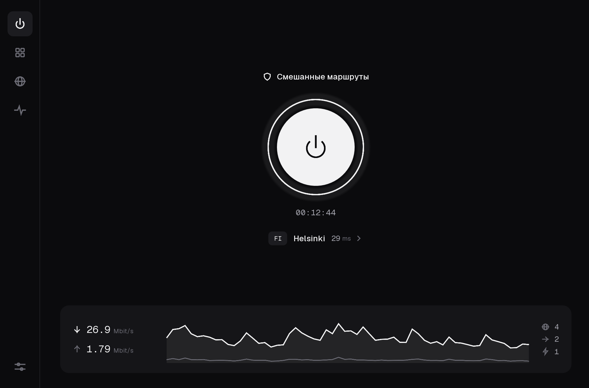
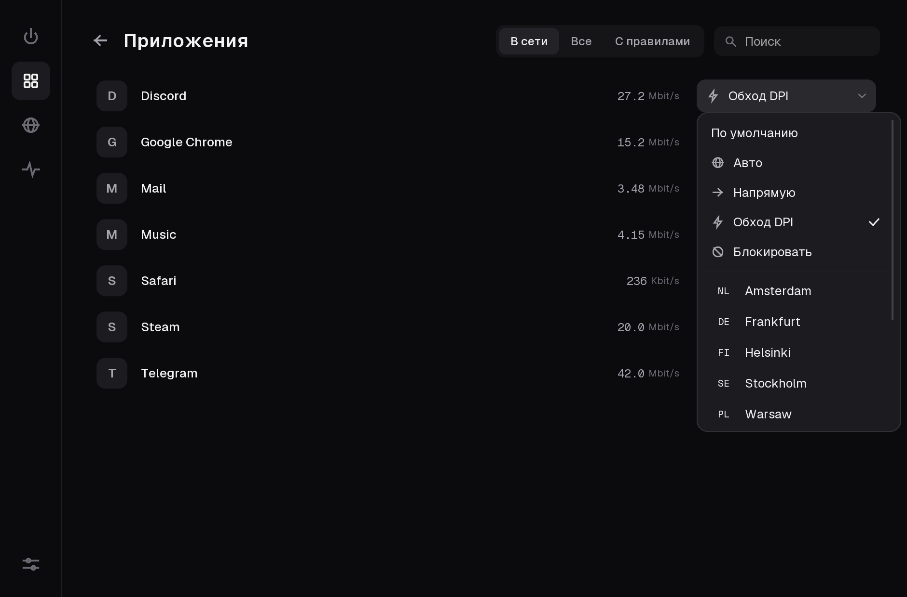
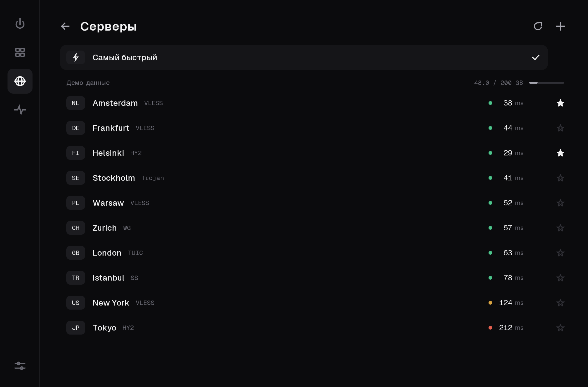
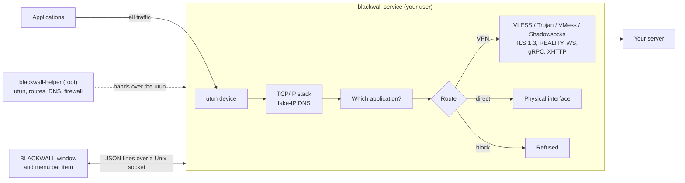

<h1 align="center">BLACKWALL</h1>

<p align="center">
  A small, fast VPN client that routes every application its own way.<br>
  Written in Zig. No Electron, no bundled proxy core, no telemetry.
</p>

<p align="center">
  
  
  
  
</p>

<p align="center">
  
</p>

BLACKWALL is a client for the servers you already have: paste a subscription link or a
single key, and it carries your traffic over VLESS, Trojan, Shadowsocks or VMess. What
sets it apart is where the decisions are made. Every application gets its own route
(through the VPN, through one particular server, straight to the internet, or nowhere),
and the protection around those routes is built so that an application you sent through
the VPN never quietly falls back to your real address.

It is one codebase with its own data plane: the TCP/IP stack, the TLS 1.3 and REALITY
handshakes, HTTP/2 and every protocol are implemented in this repository, in Zig. A
release is a single file of 3 to 14 MB.

> **You bring the servers.** BLACKWALL is a client. It does not sell, provide or
> recommend VPN servers, and it has no account, no backend and no analytics.

## Contents

- [Features](#features)
- [Platform support](#platform-support)
- [Protocols and transports](#protocols-and-transports)
- [Install](#install)
- [Getting started](#getting-started)
- [Routes](#routes)
- [Protection](#protection)
- [How it works](#how-it-works)
- [Security model](#security-model)
- [Build from source](#build-from-source)
- [Testing](#testing)
- [Project layout](#project-layout)
- [Known limitations](#known-limitations)
- [Roadmap](#roadmap)
- [Contributing](#contributing)
- [License](#license)

## Features

**Routing**

- A route per application: VPN, a pinned server, direct, or blocked. All of them work at
  the same time.
- Programs an application starts follow its rule: a shell, `git` or `curl` launched by an
  app is routed like that app unless it has a rule of its own.
- A route per site: `youtube.com` and everything under it, for the applications without a
  rule of their own (an application held to the VPN stays there whatever it opens). The
  name comes from the tunnel's DNS, or from the connection's first bytes (TLS SNI, HTTP
  Host) when the system resolves on its own.
- DPI bypass: a direct route whose TLS ClientHello leaves in a shape that filters
  matching the site's name do not recognise, picked per host from three ways.
- A default route for everything without a rule.
- Live traffic per application, and a history graph.

**Servers**

- Subscriptions by link, or keys pasted one by one. Several subscriptions at once.
- A QR code instead of typing: from the camera or a picture on Android, from the clipboard
  or the screen on a computer, read by a decoder in this repository.
- Latency for every server; "Fastest" picks one for you.
- Reserve servers: star the ones you trust. When the server in use stops carrying
  traffic, BLACKWALL reconnects to it once, then moves to the starred ones, fastest first,
  checking each with a real request. It moves back when the main server answers again.

**Protection**

- Kill switch, selective or strict.
- Protection after Disconnect: applications with a VPN rule of their own stay offline
  while the VPN is off.
- Hold from boot (macOS): traffic is held from the moment the system starts until the
  VPN is up, so applications that launch at login cannot get out first. On Android the
  system's own "Always-on VPN" does the same.
- Detection of another VPN that stands in the way, with a way to stop it.

**Everyday use**

- A background service carries the traffic. Close the window and nothing changes.
- A menu bar / tray item with the state, the server, the current speed and the two or
  three actions you need.
- Signed automatic updates. Settings, subscriptions and rules are kept.
- A report for GitHub issues in Settings: the recent log as a file, with links, keys and
  the addresses of servers and sites taken out.
- English, Russian and Chinese.

<p align="center">
  
  
</p>

## Platform support

| | macOS (Apple Silicon) | Android 10+ | Linux (x64) | Windows (x64) |
|---|---|---|---|---|
| Capture all traffic (TUN) | Yes | Yes | Yes | Yes (Wintun) |
| Routes per application | Yes | Yes | Yes | Yes |
| Local SOCKS5 proxy (`127.0.0.1:1080`) | Yes | No | Yes | Yes |
| Protection after Disconnect | Yes | Yes | Yes | Yes |
| Kill switch | Yes (pf) | Android's own "Always-on VPN" | Yes (nftables) | Yes (WFP) |
| Traffic held from boot | Yes | Android's own "Always-on VPN" | No | No |
| Menu bar / tray / notification | Yes | Yes | Built, untested | Built, untested |
| Automatic updates | Yes | No | Yes | Yes |

macOS is the platform used and tested every day. The Android app has been through an
emulator (Android 16, arm64) from first start to a reboot with "Block connections without
VPN" on, and not through daily use on a phone yet. On Linux the capture, the routes per
application, the protection after Disconnect and the strict kill switch pass an end-to-end
test in a virtual machine (Alpine, kernel 6.18); the window and the tray have not been
through a real desktop yet. Linux needs kernel 5.7 or newer. On Windows the capture
through Wintun, the routes per application, the system service with its install and
signed upgrade, and both kill switch modes pass an end-to-end test on a Windows machine
in CI on every push; protection after Disconnect runs on the same path but has no test
of its own there, and the window and the tray have not been through a real desktop yet.

## Protocols and transports

| Protocol | Security | Transports |
|---|---|---|
| VLESS | REALITY (with Vision), TLS, none | TCP, WebSocket, HTTPUpgrade, gRPC, XHTTP |
| Trojan | TLS, REALITY | TCP, WebSocket, HTTPUpgrade, gRPC, XHTTP |
| VMess (AEAD) | TLS, REALITY, none | TCP, WebSocket, HTTPUpgrade, gRPC, XHTTP |
| Shadowsocks | AEAD (AES-GCM, ChaCha20) and 2022 (BLAKE3) | TCP, UDP |

Every combination above is checked against a real [Xray](https://github.com/XTLS/Xray-core)
server: a download, an upload and a small request per link. UDP goes through every
protocol and is checked the same way, a datagram and a DNS query per protocol
(`blackwall-proxy udp <link> <ip:port>`). Link formats understood:
`vless://`, `trojan://`, `ss://`, `vmess://` (both the base64 JSON and the URL form), and
Xray JSON subscriptions.

The TLS ClientHello follows Chrome's, the WebSocket and HTTPUpgrade requests match Xray's
byte for byte, and server certificates are always verified. A server whose front answers
the WebSocket or HTTPUpgrade request with 5xx (its backend away for a moment) is dialed
again, up to five times over three seconds, as Xray does.

## Install

Download the file for your system from the [releases](../../releases) page. Each release
comes in three languages; pick the one you read.

| System | File |
|---|---|
| macOS (Apple Silicon) | `BLACKWALL-<version>-<lang>-macos-arm64.zip` |
| Windows (x64) | `BLACKWALL-<version>-<lang>-windows-x86_64.exe` |
| Linux (x64) | `BLACKWALL-<version>-<lang>-linux-x86_64.tar.gz` |
| Android 10+ (arm64, x86_64) | `BLACKWALL-<version>-android.apk` (every language in one file) |

The builds are not signed by Apple or Microsoft yet:

- **macOS**: right-click the app, choose Open. The first connection in TUN mode asks for
  the administrator password once, to install the network helper.
- **Windows**: SmartScreen, More info, Run anyway. The first Connect asks once (UAC) to
  install the BLACKWALL system service, which carries the traffic; later releases replace
  it by themselves. See [docs/windows.md](docs/windows.md).
- **Linux**: unpack the archive and run `./install.sh`, which puts BLACKWALL into the
  applications menu for your user (no root). The first Connect in TUN mode asks for your
  password once, through the system's dialog, to give `blackwall-tun` its network
  permission.
- **Android**: open the APK and allow the installation from that source. The first
  connection asks once whether the app may be a VPN. The app is also on its way to
  Google Play; the APK from here and the app from Google Play are signed differently, so
  one does not update the other.

Every release file has a `.sig` next to it, an Ed25519 signature the updater checks
before it installs anything. See [docs/updates.md](docs/updates.md).

## Getting started

1. Open **Servers**, press **+**, and paste a subscription link or a key.
2. Go back and press the power button.
3. Open **Apps** to give an application its own route.
4. Star a few servers you trust. They become the reserve.

Explanations of every option live in **Settings**. The main screens stay free of text on
purpose.

## Routes

| Route | Where the application's traffic goes |
|---|---|
| Default | Wherever "Default route" in Settings says: the VPN or direct |
| Auto | Through the VPN, on the main server (or its reserve) |
| A server from the list | Through that server and no other. If it cannot be used, the application is blocked, never sent direct |
| Direct | The normal internet, with your real address |
| DPI bypass | Direct, with the TLS ClientHello split so that name filters miss it |
| Block | No network |

The same routes apply to sites. An application's own rule (or that of the application
that started it) comes first; a site's rule takes the rest.

A route that goes through the VPN has exactly two fallbacks: another VPN server from the
reserve, or no connection. There is no path from a VPN route to a direct connection.

## Protection

**Kill switch.** *Selective* stops the applications that are routed through the VPN when
it drops; direct ones keep working. *Strict* stops everything except the connections to
the VPN servers themselves, using the system firewall (pf).

**Protection after Disconnect.** Turning the VPN off is not the same as lifting the
protection. Applications with their own VPN rule, and blocked ones, stay offline while the
VPN is off; everything else uses the normal internet.

**Hold from boot.** With "Launch at login" on, the network helper captures all traffic as
soon as the system has a network and holds it until the service takes over. If no
service comes within two minutes of a login, it lets go, so a broken installation cannot
leave the machine offline.

**Reserve.** Recovery is driven by failures, not by polling: nothing runs while the server
works. When connections start failing, the address is looked up again and one real request
is sent through the same server. If that fails, the starred servers that accept a
connection are tried fastest first, each with a real request.

## How it works



Three processes, each with one job:

- **The window** shows the state and edits the configuration. It carries no traffic and
  can be closed.
- **The service** runs as your user and is the whole data plane: a TCP/IP stack in user
  space that terminates every connection the system sends into the tunnel, finds the
  application behind it, picks its route and carries it.
- **The helper** (macOS) is a small root daemon that does only what needs root: it creates
  the tunnel device, sets the routes and the DNS, holds the firewall rules of the strict
  kill switch, and hands the device to the service. If the service dies, the helper keeps
  the traffic captured instead of letting it leak.

A few details worth knowing:

- **Fake-IP DNS.** Name lookups are answered with addresses from `198.18.0.0/15`, so each
  connection arrives with its domain name and the server resolves it. Your resolver does
  not see where proxied applications go.
- **Application identity.** A connection is matched to a process through the kernel's
  socket tables, and the process to the outermost `.app` bundle that contains it. When a
  process has no rule, the applications that started it are asked, nearest first.
- **No external core.** There is no Xray, sing-box or OpenSSL inside. The protocol code
  is a few thousand lines per protocol, allocates almost nothing per connection, and is
  tested against the reference servers.

## Security model

- **Least privilege.** On macOS only the helper runs as root, and it runs no shell and no
  command the caller chooses. Every value it receives is validated before it reaches an
  `ioctl`, a route message or a command line. It serves one user: the one who installed
  it. On Linux nothing runs as root: `blackwall-tun` holds one capability,
  `CAP_NET_ADMIN`, granted to that file once through polkit. It creates the device, its
  routes and the kill switch's nftables table, hands the device to the service and exits.
  The service and the window run as you, with no capability, so updating them asks for
  nothing; the updater replaces `blackwall-tun` only when it changed.
- **Stopping another VPN** is done only for a process whose identity (pid, start time,
  executable) was re-checked at the moment of stopping, and never for a system process.
- **Updates are signed.** The updater installs a file only when its Ed25519 signature
  matches the public key built into the running app, and only when the unpacked app really
  is the expected, newer version. The helper accepts a newer helper on the same terms, so
  the administrator password is asked once per installation.
- **Fail closed.** A VPN route whose server is gone, unknown or unsupported is blocked. A
  connection whose application cannot be identified is refused while protected
  applications are being held.
- **Secrets stay local.** Subscription links and keys are stored in the configuration file
  in your user folder and are never logged.

Found a security problem? Please report it privately to the maintainers rather than in a
public issue.

## Build from source

You need [Zig 0.17.1](https://ziglang.org/download/). Everything else is fetched by the
build.

```sh
zig build                 # the app, the service and the tools, into zig-out/
zig build run             # build and start the window
zig build test            # all tests
zig build package -Doptimize=ReleaseSafe -Dlang=en    # a release file in zig-out/package
```

| Option | Meaning |
|---|---|
| `-Dlang=en\|ru\|zh` | Interface language (one build per language; default `ru`) |
| `-Dtarget=...` | Cross-compile, for example `x86_64-windows` or `x86_64-linux-gnu` |
| `-Doptimize=ReleaseSafe` | Release build |
| `-Dupdate-repo=owner/name` `-Dupdate-pubkey=<base64>` | Build with the updater (release CI does this) |

On macOS, `zig build package` produces `zig-out/BLACKWALL.app` with the service and the
helper inside, ad-hoc signed.

Releases are built by GitHub Actions from a `v<version>` tag; see
[docs/updates.md](docs/updates.md) for the signing key and the release steps.

### Android

```sh
export ANDROID_HOME=~/Library/Android/sdk     # an SDK with a platform, build-tools and an NDK
export JAVA_HOME=/path/to/jdk-17
zig build android -Doptimize=ReleaseSafe      # zig-out/package/BLACKWALL-<version>-android.apk
```

There is no Gradle: Zig builds the core as `libblackwall.so` against the NDK's libc, and
[android/build.sh](android/build.sh) compiles and packs the shell with the SDK's own tools
(`aapt2`, `javac`, `d8`, `zipalign`, `apksigner`). The APK is about 3 MB. See
[docs/android.md](docs/android.md) for how the app is put together and how releases are
signed.

## Testing

```sh
zig build test
```

The suite covers the protocol code against recorded and scripted peers, the TCP/IP stack,
the routing table, the recovery logic and the release tooling, and runs on macOS, Linux and
Windows in CI on every push. The Linux capture, routes per application, protection after
Disconnect and the strict kill switch also have an end-to-end test in a virtual machine;
on Windows [tools/windows/e2e.ps1](tools/windows/e2e.ps1) and
[upgrade.ps1](tools/windows/upgrade.ps1) do the same on a CI machine (the adapter, routes
per application, the service, the kill switch, a signed upgrade and a forged one); the
Android app is checked in an emulator.

Two tools help when working on the data plane:

```sh
# a local SOCKS5 proxy through one server, with counters
zig-out/bin/blackwall-proxy 1080 'vless://...'

# does this server accept a connection, and does a real request get through?
zig-out/bin/blackwall-proxy check 'vless://...'
```

To render every screen to PNG without touching your configuration (sample data):

```sh
HOME=$(mktemp -d) BLACKWALL_SHOTS=out zig-out/bin/blackwall
```

## Project layout

```
src/
  main.zig, app.zig        the window: frame loop and application state
  link.zig                 the window's side of the background service
  ui/                      screens, widgets, theme
  platform/                autostart, tray, detection of other VPNs
  core/                    everything that is not the window
    proxy.zig              outbounds, dialing, one flow from end to end
    tunnel.zig             the TUN data plane: flows, routes, UDP
    ipstack/               TCP/IP stack, packets, DNS and fake addresses
    tls13.zig, vision.zig  TLS 1.3, REALITY, Vision
    ws.zig, httpupgrade.zig, grpc.zig, xhttp.zig, h2.zig, hpack.zig
    trojan.zig, vmess.zig, shadowsocks.zig, xudp.zig
    failover.zig           the main server and its reserve
    sublink.zig            subscriptions and links
    update.zig             the updater
  service/                 the background service
  android/                 the core as a library for the Android app
  helper/                  the root helper (macOS)
tools/windows/             end-to-end checks on a Windows machine
  tools/                   release signing, headless proxy
android/                   the Android shell: VpnService, the window, resources
docs/                      updates, Android, release notes
```

## Known limitations

- Windows: the list of applications comes from the Start menu shortcuts that point at a
  program (Store apps and installer-advertised shortcuts are not in it yet; they can still
  follow the default route); traffic is not held from boot; IPv6 resolvers of the network
  are not captured.
- Linux: a connection is matched to its application only for your own processes (another
  user's daemons follow the default route); programs in Flatpak or Snap, and those
  started through a wrapper script, appear under their real executable once they have had
  traffic. The kill switch covers this machine's own traffic, not that of containers or
  virtual machines it forwards.
- Android: no automatic updates, no pinned server per application in the interface yet,
  and with "Block connections without VPN" on, Android itself cuts off the applications
  set to Direct.
- QUIC from proxied applications is dropped on purpose so that browsers fall back to TCP.
  Other UDP goes through every protocol (XUDP over VLESS and VMess, UDP associations over
  Trojan, Shadowsocks UDP), except Shadowsocks 2022 through a relay (identity headers),
  where it is dropped.
- XHTTP supports the stream-one mode.
- "DPI bypass" reshapes the TLS ClientHello of a direct connection (two records, two
  segments, or the first segment with TTL 1, whichever gets through for that host). It
  helps against filters that match the site's name; a site blocked by its address stays
  blocked. Plain HTTP and QUIC are not reshaped (QUIC is dropped on that route so browsers
  use TLS over TCP).
- A changed route applies to new connections; open ones finish on the route they started
  with.
- DNS queries other than address lookups are forwarded to the network's own resolver.
- The apps are not notarized or signed by Apple or Microsoft.

## Roadmap

- **0.4** — Windows on a real desktop: the window and the tray, Store applications in the
  list, traffic held from boot.
- **0.5** — WireGuard.
- **0.6** — QUIC and Hysteria2.
- **0.7** — TUIC.

## Contributing

Issues and pull requests are welcome. A few things keep the project the size it is:

- Prefer the lighter design even when it is harder to write. There is a budget: the
  package stays small and the service stays cheap when idle.
- A new protocol or transport comes with tests against the reference server.
- The main screens carry almost no text. Explanations go into Settings.
- `zig build test` passes on all three systems before a change lands.

## License

[MIT](LICENSE).

BLACKWALL is built with [Zig](https://ziglang.org), [DVUI](https://github.com/david-vanderson/dvui)
and [SDL](https://libsdl.org), and is tested for compatibility against
[Xray](https://github.com/XTLS/Xray-core).
